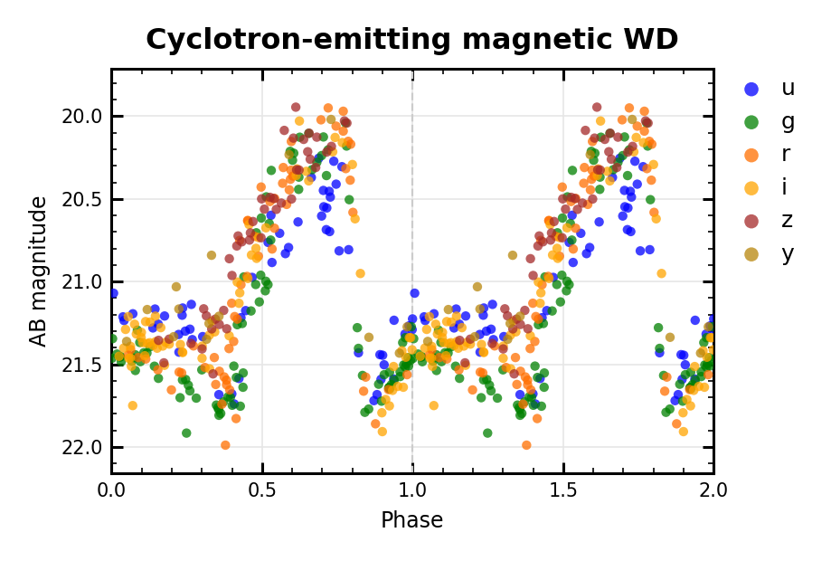
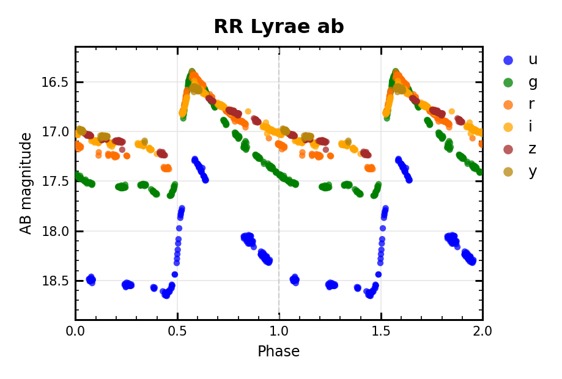
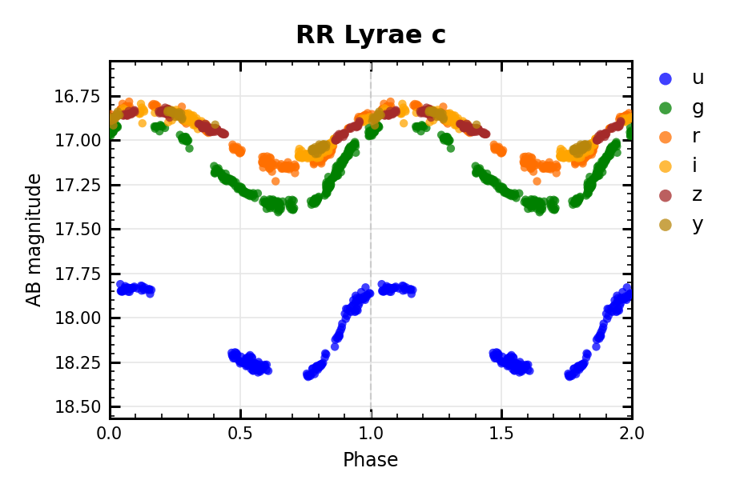
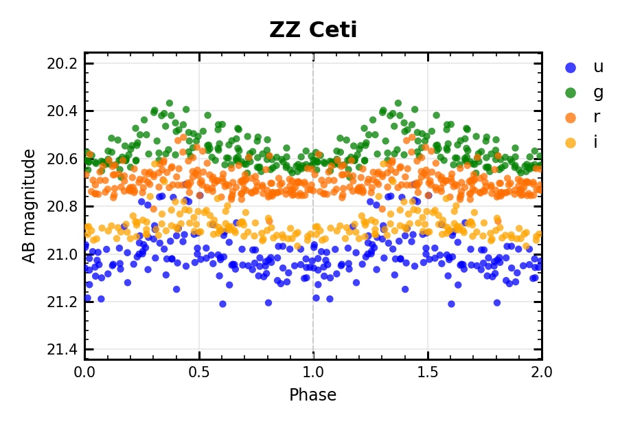
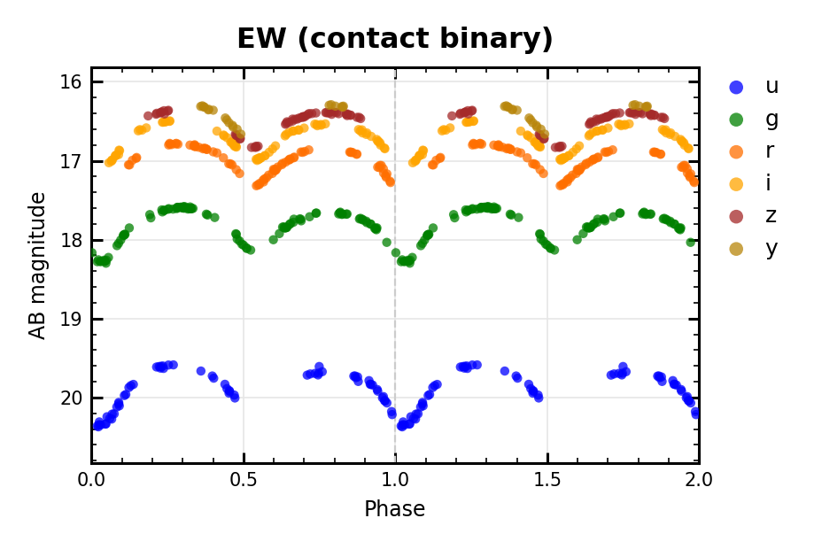
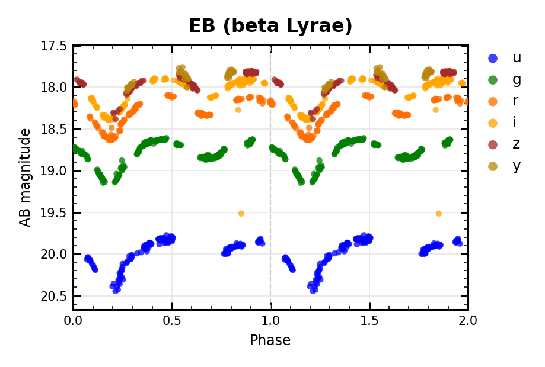
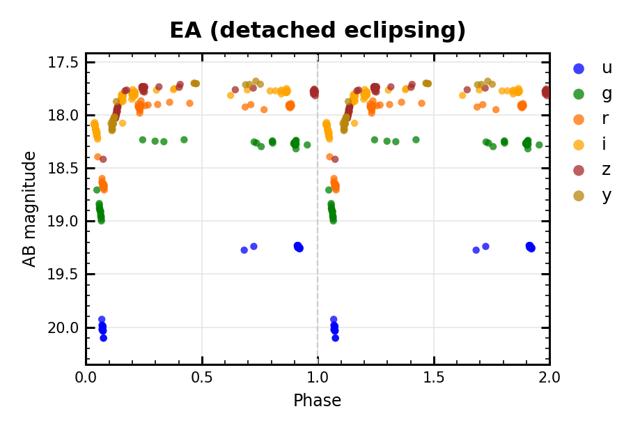
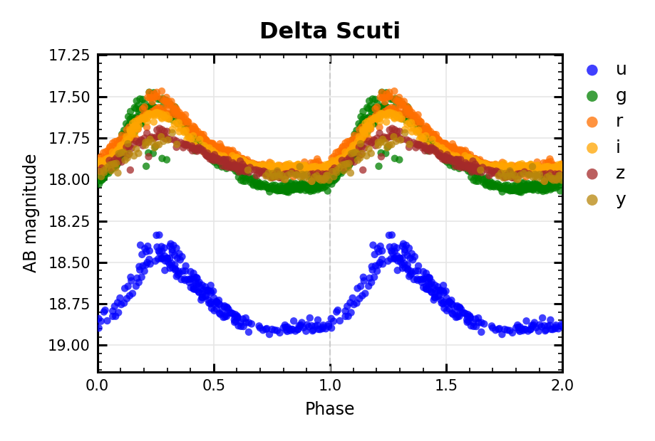
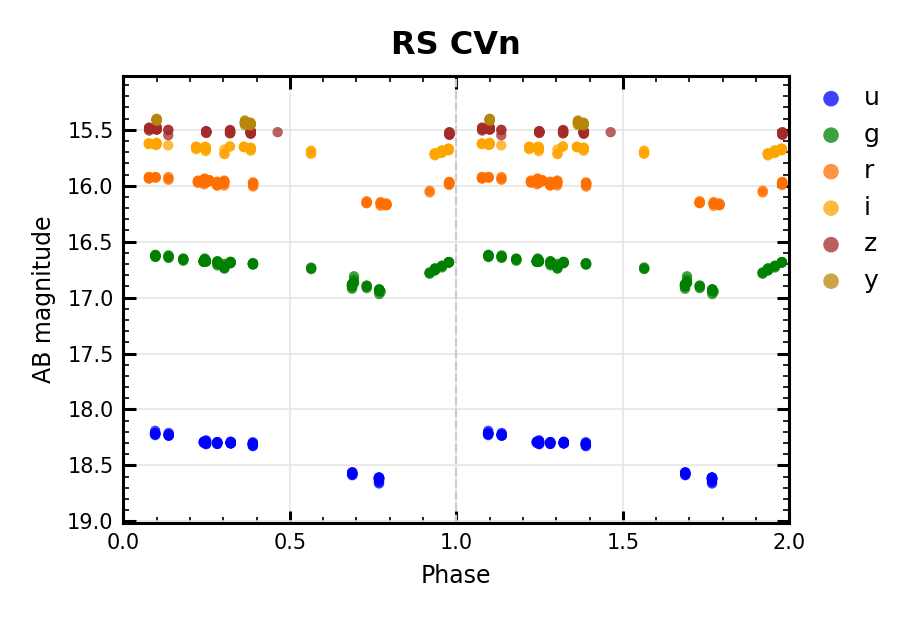

# Rubin DP2

Code for the Rubin Data Preview 2 (DP2) variable-star work.

| Folder | Contents |
|---|---|
| `classifier/` | the DP2 variable-star classifier: self-supervised pretraining code (`v1/`, `v2/`); see its README |
| `labels/` | `pull_dp2_labels.py`, which pulls the current DP2 classifications and periods from Orcus (below) |

## DP2 labels and periods

`labels/pull_dp2_labels.py` downloads the current classifications and periods of Rubin DP2 objects from
[Orcus](https://orcusgate.org) and writes them to two tables:

| File | Contents |
|---|---|
| `dp2_variables.csv` | objects in the Orcus group "Rubin DP2 Variables" |
| `dp2_transients.csv` | objects in the Orcus group "Rubin DP2 Transients" |

Only objects with at least one classification in the LSST/Rubin Taxonomy are included. The labels are updated as
scanning continues, so running the script again gives the latest version.

### Access

1. You need an Orcus account that is a member of the Rubin DP2 group(s). Ask a group admin to add you; a group you are
   not in is skipped with a note.
2. Create an API token in your Orcus profile (read access is enough).

### Run

```
python labels/pull_dp2_labels.py --token YOUR_ORCUS_TOKEN
```

or set the token once with `export ORCUS_TOKEN=YOUR_ORCUS_TOKEN` and run `python labels/pull_dp2_labels.py`.
Only the Python standard library is needed (`pyarrow` for `--format parquet`).

| Option | Meaning |
|---|---|
| `--groups variables transients` | which groups to pull (default: both) |
| `--min-prob 0.7` | ignore classifications with a lower probability |
| `--exclude-classes CLASS ...` | leave these classes out |
| `--format csv\|parquet` | output format (default csv) |
| `--outdir DIR` | where to write the files |

### Columns

| Column | Meaning |
|---|---|
| `id` | DP2 `diaObjectId` |
| `ra`, `dec` | position in degrees |
| `class` | majority class: each person counts once (their latest classification); classes tied at the top are all listed, separated by `; ` |
| `votes` | how many people chose the class, out of how many classified the object, e.g. `2 of 3` |
| `period` | the set period in days (the `period` field of the object's annotation named `period` on Orcus); empty unless the class is periodic (pulsators, binary stars, the periodic branch and cyclotron-emitting magnetic white dwarfs) |
| `groups` | the Orcus DP2 group(s) the object is in |
| `author_1`, `classification_1`, `probability_1`, `author_2`, ... | every person's latest classification, one set of three columns per person (those agreeing with the majority class first, then by probability); there are as many sets as the most-classified object in the file needs, empty for objects with fewer |

Machine-learning classifications are not counted.

## Some examples of variable stars found in DP2

Light curves folded at their period and shown over two cycles, in AB magnitudes in the six Rubin bands.



















## Citation

If you use the labels or periods, please cite Atal Agrawal et al., "The Rubin Source Classification Project: I. Period
Estimation and Recognition of Variable Stars in Data Preview 2", in preparation.
